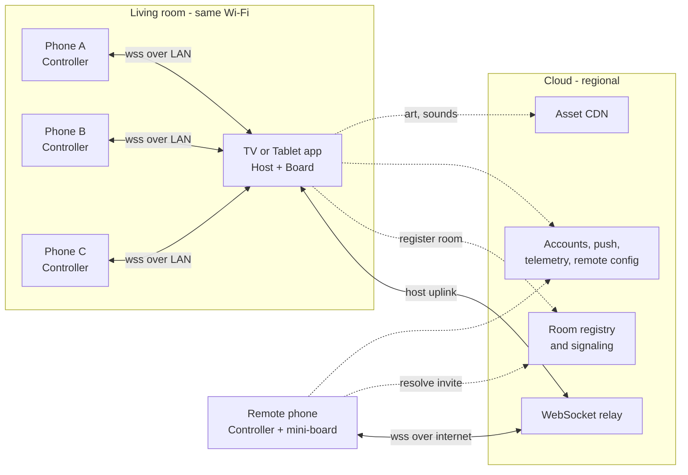
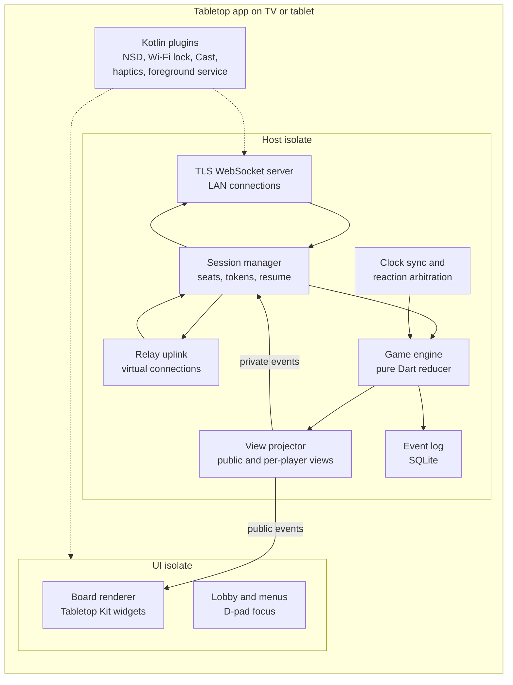
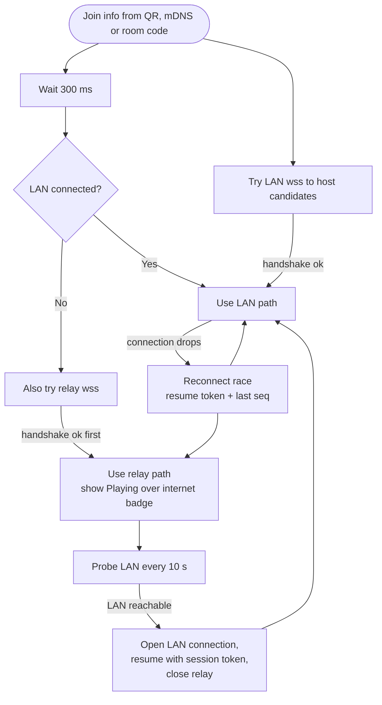
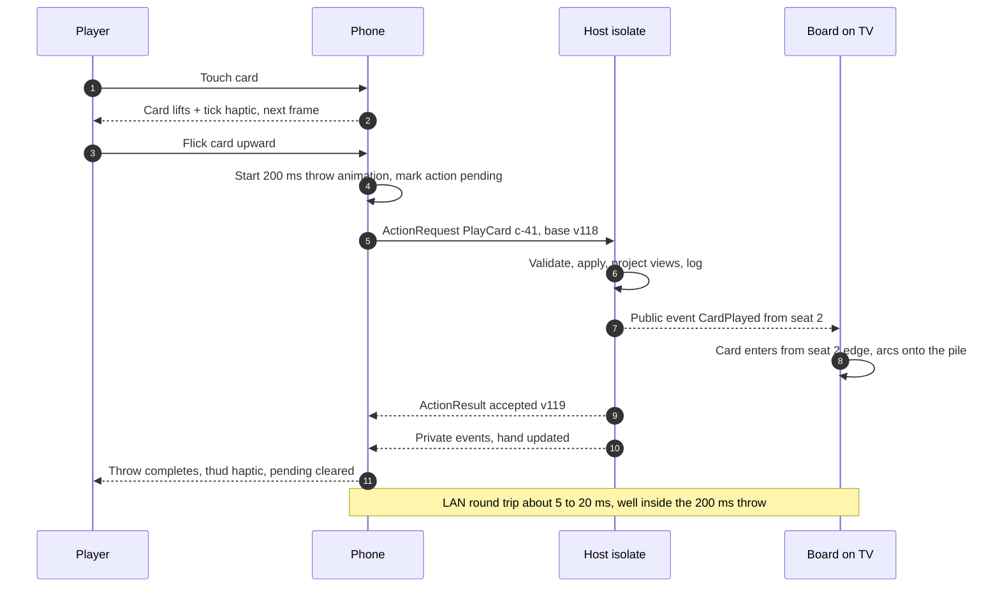

# Tabletop Platform — Architecture Plan

**Shared-screen multiplayer board and card games: the table on a TV or tablet, a private hand on every phone.**

| | |
|---|---|
| Codename | Tabletop (placeholder — replace with the product name) |
| Version | 0.1 (initial architecture) |
| Date | 24 Nov 2026 |
| Author | Sarvajeet Ashwingada |
| Scope decisions | Same-room play on local Wi-Fi with remote friends joining over the internet; board on Android TV / Google TV, Android tablet, and Cast; Android phones as controllers (iOS later) |

> Diagrams use Mermaid code blocks. They render on GitHub, GitLab, Azure DevOps wikis, Obsidian, and VS Code (with a Mermaid preview extension).

---

## Contents

1. [Executive summary](#1-executive-summary)
2. [Goals, constraints and quality targets](#2-goals-constraints-and-quality-targets)
3. [Device roles and deployment topologies](#3-device-roles-and-deployment-topologies)
4. [System architecture overview](#4-system-architecture-overview)
5. [Technology stack recommendation](#5-technology-stack-recommendation)
6. [Game engine and Game SDK](#6-game-engine-and-game-sdk)
7. [Networking and latency](#7-networking-and-latency)
8. [Remote play and cloud services](#8-remote-play-and-cloud-services)
9. [Casting strategy](#9-casting-strategy)
10. [UI/UX system](#10-uiux-system)
11. [Rendering performance on TV hardware](#11-rendering-performance-on-tv-hardware)
12. [Security, privacy and fairness](#12-security-privacy-and-fairness)
13. [Resilience and recovery](#13-resilience-and-recovery)
14. [Testing and observability](#14-testing-and-observability)
15. [Repository and module structure](#15-repository-and-module-structure)
16. [Delivery roadmap](#16-delivery-roadmap)
17. [Risks and open questions](#17-risks-and-open-questions)
18. [Appendices](#18-appendices)

---

## 1. Executive summary

The platform is **host-authoritative and state-synchronised**. Whichever device shows the table (an Android TV, a Google TV, a tablet, or, when casting to a plain Chromecast, the phone that started the cast) also runs the game engine and a small secure WebSocket server. Phones in the room connect straight to it over Wi-Fi, so a move travels a single Wi-Fi hop (typically 2–10 ms) and never touches the internet. Remote friends connect to a thin cloud relay that forwards their traffic to the same host. In-room players never pay internet latency because someone remote joined.

Devices exchange **game state and events, never video**. Every screen renders the game itself from small messages (actions under 200 bytes, events under 1 KB), which is what keeps latency low and lets the TV render at full quality.

Every screen is built with **Flutter** from one codebase, and every game is a **pure, deterministic Dart state machine** that plugs into a shared **Tabletop Kit**: cards, hands, piles, dice, tokens, track boards, hex boards, timers, trade and bid panels. That shared kit lets you go from Ludo to an Uno-style game to a Catan-style game to whole families of card games (trick-taking, shedding, rummy, climbing) without re-architecting. Each new game is mostly rules plus art.

Phones **never wait on the network to respond to touch**. A card lifts and the phone buzzes within one frame. When the player flicks it, the phone plays a short throw animation that hides the network round trip, and by the time that animation ends the TV is already showing the card landing on the table from that player's seat. That continuity between screens is the core of the "world-class" feel.

### Key decisions at a glance

| # | Decision | Choice | Why |
|---|---|---|---|
| D1 | Authority model | Host-authoritative: the table device runs the engine | Lowest in-room latency, works offline, and keeps hands secret by sending each phone only its own redacted view |
| D2 | What travels on the wire | State and events, never pixels | Messages are tiny, each screen renders at native quality, and there is no video-encoding delay |
| D3 | UI technology | Flutter on TV, tablet and phone (one app, role-adaptive) | Game-grade 60/120 fps rendering, Rive and shader ecosystem, one codebase, iOS later for free |
| D4 | Game logic | Pure Dart engine package with no Flutter dependency | Runs in a background isolate, in tests, in bots, and later on a Dart server for online rooms |
| D5 | Local transport | Secure WebSocket (TLS 1.3, certificate pinned via QR) over Wi-Fi | Reliable and ordered, simple, private even on shared Wi-Fi |
| D6 | Remote transport | Regional WebSocket relay; host keeps one uplink | Remote seats look identical to local seats in host code; the relay holds no game logic |
| D7 | Join flow | QR code on TV (App Link carrying LAN address and pairing key), plus room code and mDNS | Seated in under 10 seconds with no typing |
| D8 | Wire format | Protocol Buffers envelope + per-game payloads | Schema evolution across app versions, compact, code generation for Dart/Kotlin/Go |
| D9 | Casting | Cast Connect launches the native TV app on Google TV; Web Receiver and screen mirroring as fallbacks | Best quality where the app can run, graceful degradation elsewhere |
| D10 | Extensibility | Tabletop Kit primitives + game "families" + house-rule config | New card games become configuration plus art, not new architecture |

---

## 2. Goals, constraints and quality targets

### 2.1 Product goals

The experience should feel like sitting around a real table, only better. The TV is the shared stage where everything public and dramatic happens: the board, the discard pile, dice rolls, scores, celebrations. Each phone is a private, tactile hand: your cards, your choices, haptic feedback, secrets. Joining a game should take seconds, games should never feel laggy, a dropped Wi-Fi connection should never end a game, and a friend in another city should be able to take a seat at the same table.

### 2.2 Constraints from the kickoff

Same-room play over local Wi-Fi is the primary path, and remote players must be able to join the same table over the internet. Table devices are Android TV / Google TV, Android tablets, and TVs reached by casting. Controllers are Android phones today. The architecture keeps iOS controllers cheap to add later, because Flutter and the pure-Dart engine both run on iOS unchanged.

### 2.3 Non-goals for v1

Version 1 does not include fully online matchmaking with strangers, ranked play, real-money wagering of any kind, 3D board rendering, or a user-generated game editor. The architecture leaves room for the first two (see [8.5](#85-later-cloud-authoritative-online-rooms)); real-money play is excluded on purpose (see [17](#17-risks-and-open-questions)).

### 2.4 Quality targets (SLOs)

These are the numbers the architecture is designed to meet. Measure them on the reference devices in [11.1](#111-reference-devices-and-budgets), not on flagships.

| Area | Target | How it's measured |
|---|---|---|
| Touch to local feedback on phone (card lift, haptic) | ≤ 1 frame (≤ 16 ms at 60 Hz, ≤ 8 ms at 120 Hz) | Frame timing around gesture start |
| Local: release on phone → first frame of the card on TV | p50 ≤ 50 ms, p95 ≤ 100 ms (excluding TV panel processing) | Synchronised timestamps on phone, host and board |
| Remote: release on phone → first frame on TV | p50 ≤ 150 ms, p95 ≤ 300 ms | Same, via relay |
| Action acknowledged back to the acting phone (LAN) | p95 ≤ 40 ms | `ActionRequest` → `ActionResult` timing |
| TV frame rate during gameplay animations | 60 fps sustained, < 1% janky frames on the low-end reference TV | Flutter `FrameTiming` telemetry |
| QR scan → seated in lobby (app already installed) | ≤ 10 s | Funnel telemetry |
| Reconnect after a Wi-Fi blip or app resume | ≤ 1 s to a fully resumed seat | Resume telemetry |
| Host crash or TV power loss | Game resumable, with no lost moves | Event-log recovery tests |
| Hidden information | A phone never receives another player's private data | Engine property tests + wire inspection in CI |

---

## 3. Device roles and deployment topologies

### 3.1 Three logical roles plus the cloud

The architecture separates what a device **does** from what it **is**. One device can play several roles at once.

| Role | Responsibility | Runs on |
|---|---|---|
| **Host** | Authoritative game engine, session management, per-player redaction, persistence, the LAN WebSocket server, the relay uplink | TV app, tablet app, or (when casting to a non-Android receiver) the casting phone |
| **Board** | Renders the public view: board, piles, dice, scores, seat avatars, animations and sound | TV app, tablet app, Cast Web Receiver, and a mini-board on remote players' phones |
| **Controller** | Renders the player's private view (hand, choices, legal moves) and sends intents; optimistic UI and haptics | Phone app (and the tablet itself in pass-and-play) |
| **Relay** (cloud) | Forwards encrypted frames between the host and remote controllers; room-code lookup; invites | Regional cloud service with no game logic |

### 3.2 Topologies

| Topology | Host | Board | Controllers | When it's used |
|---|---|---|---|---|
| **A. TV table** (flagship) | Android TV / Google TV app | Same TV app | Phones on LAN | Living room. The TV app is installed, or launched through Cast Connect |
| **B. Tablet table** | Tablet app | Same tablet app, in tabletop (flat) or upright mode | Phones on LAN, or the tablet itself in pass-and-play | Dining table, travel, no TV |
| **C. Cast to a plain receiver** | The casting phone or tablet | Cast Web Receiver (thin renderer) or screen mirroring | Phones on LAN; the casting phone is also a controller | TVs that only have Chromecast built-in and can't install the Android TV app |
| **D. Remote seats** | Any of the above | Any of the above, plus a mini-board on each remote phone | Remote phones via the relay | A friend or relative joins from elsewhere |
| **E. Online room** (later) | Cloud host running the same Dart engine | Each player's own device | All remote | Everyone is remote, nobody has a TV |

Topology A is where the product shines and where the most polish should go. When a phone casts to a Google TV that has the app, Cast Connect simply launches the TV app with the room details, and the session becomes topology A: the TV takes over as host, and the phone becomes a controller.

---

## 4. System architecture overview



### 4.1 Inside the host device

The host splits work across Dart isolates, so a heavy animation frame on the board can never delay a reply to a phone, and a burst of network traffic can never drop a frame.



### 4.2 Why host-authoritative instead of peer-to-peer lockstep

In lockstep, every device runs the full engine and only inputs are exchanged. That works for public-information games like chess, but it breaks for cards: every phone would need the complete state, including everyone else's hand, and anyone with a packet sniffer or a modified app could see it. A single authority that sends each player only what they are allowed to see is the only practical way to keep hands secret without cryptographic "mental poker" protocols. It also gives one place to persist, validate and arbitrate.

Cloud authority was rejected as the default because it would put two internet round trips (phone → cloud → TV) on every in-room move, and the game would stop working when the internet drops. The host-authoritative design keeps the cloud optional: local play works fully offline when players join by QR code.

---

## 5. Technology stack recommendation

### 5.1 Options compared

Scores are from 1 (weak) to 5 (strong) for this product specifically.

| Criterion | Flutter | Kotlin + Compose (KMP) | Unity | React Native + Skia | Web / WebView |
|---|---|---|---|---|---|
| Game-like 2D animation at 60/120 fps | 5 | 4 | 5 | 4 | 3 |
| One codebase across TV, tablet and phone | 5 | 4 | 3 | 4 | 4 |
| iOS controllers later | 5 | 4 | 4 | 5 | 5 |
| Same game logic on host, bots, tests, server | 5 (pure Dart) | 5 (KMP) | 3 (C#) | 4 (TS) | 5 (TS) |
| Reuse of the board renderer in a Cast Web Receiver | 3 (Flutter Web) | 2 | 2 | 2 | 5 |
| Native Android API access (NSD, Wi-Fi lock, Cast, haptics) | 4 (Kotlin plugins) | 5 | 3 | 4 | 2 |
| Rich UI for hands, trading panels and lobbies | 5 | 5 | 3 | 5 | 4 |
| App size and cold start on weak TV boxes | 4 | 5 | 2 | 3 | 3 |
| Speed of adding new games | 5 | 4 | 3 | 4 | 4 |

### 5.2 Recommendation: Flutter everywhere, a pure-Dart engine, Kotlin at the edges

**Flutter** gives you full control of every pixel with a renderer built for consistent frame pacing (Impeller), first-class support for Rive animations and custom fragment shaders (card foil, felt lighting, glow), and Flame if a board ever needs a continuous game loop. Above all, the *same* board widget renders on the TV, on the tablet, and as the mini-board on a remote player's phone. That last point matters for remote play: without it you would build every board twice.

**Kotlin + Jetpack Compose** (with Kotlin Multiplatform) is the strong runner-up and the better choice if your team is already deeply native-Android. You would give up some rendering and animation ecosystem maturity for game-style UIs, and you'd write more of the board renderer yourself. **Unity** is excellent for 3D but heavy for this product: it is weaker for the phone-side UI (hands, menus, trade panels), larger, and slower to start on weak TV boxes. **Web technologies** are the best fit for a Cast Web Receiver but the weakest on TV-box rendering performance and native API access. They are recommended only for that receiver, if it is built at all (see [9](#9-casting-strategy)).

### 5.3 The stack, layer by layer

| Layer | Choice | Notes |
|---|---|---|
| App (all form factors) | Flutter (stable channel), **one app** that adapts by role and form factor | One Play listing covering phone, tablet and TV keeps versions aligned across devices |
| Rendering and motion | Flutter animation framework, Rive, fragment shaders; Flame only where a game loop is needed (for example, dice physics) | Impeller on modern devices; validate older TV GPUs, which may take a fallback rendering path |
| App state | Riverpod (or Bloc), with the engine kept outside the widget tree | The UI subscribes to view models derived from engine views |
| Game engine | Pure Dart packages with zero Flutter imports | Runs in an isolate, in CI simulations, and later on a Dart server |
| Wire protocol | Protocol Buffers v3 | Envelope plus per-game payload bytes; code generation for Dart, Kotlin and Go |
| Host server | `dart:io` `HttpServer` + WebSocket in a dedicated isolate, TLS 1.3 | Per-install self-signed certificate; the client pins its SHA-256 fingerprint from the QR code |
| Persistence | SQLite via `drift` | Append-only action log plus periodic snapshots |
| Android platform layer | Kotlin Flutter plugins | `NsdManager` (mDNS), `WifiManager` low-latency lock, `Window.setPreferMinimalPostProcessing`, `VibrationEffect.Composition`, Cast Connect, foreground service, App Links, Play In-App Updates |
| Relay | Go service (or Rust), deployed regionally; Cloudflare Durable Objects as a managed alternative | Stateless per frame; one room pinned to one node |
| Room registry | Redis with TTLs (or Durable Object storage) | Room code → LAN candidates, certificate fingerprint, relay node |
| Backend as a service | Firebase: Anonymous Auth, Cloud Messaging, Crashlytics, Remote Config, Analytics | Guest-first; anonymous accounts can later be upgraded to Google sign-in |
| Assets | CDN plus Play Asset Delivery | Art, sound and themes only. Executable code always ships inside the app (Play policy) |
| Voice chat (later) | WebRTC through a hosted SFU (for example LiveKit) | For remote seats; ducks game audio on the TV |

---

## 6. Game engine and Game SDK

The engine is the part that decides how many games you can ship, so it is designed as a small, strict contract that every game implements, plus a large shared kit that games compose.

### 6.1 The game contract

A game is a pure function from (state, action) to (new state, events). It does no I/O, reads no clocks and uses no global randomness. Everything it needs comes in through the context, which makes every game replayable, testable, simulatable by bots, and portable to a server.

```dart
/// Implemented once per game (or once per game family, with config).
abstract interface class GameDefinition<S, A> {
  GameInfo get info;                      // id, name, version, min/max players, tags
  GameCodec<S, A> get codec;              // protobuf encode/decode for state, actions, views

  S setup(GameConfig config, List<SeatId> seats, Rng rng);

  /// Who may act right now, and how (see 6.2).
  Stage stage(S state);

  /// Every action this seat may take now. Drives highlighting on phones and bots.
  List<A> legalActions(S state, SeatId seat);

  /// Validate and apply. Pure: same inputs always give the same result.
  Transition<S> apply(S state, SeatId seat, A action, Rng rng);

  /// Projections. The host sends ONLY these, never raw state.
  PublicView publicView(S state);                  // for the board and spectators
  PrivateView privateView(S state, SeatId seat);   // for that seat's phone

  Outcome? outcome(S state);                       // null while the game is running
}

sealed class Transition<S> {}
final class Applied<S> extends Transition<S> {
  final S next;
  final List<GameEvent> events;   // each event tagged with an Audience (see 6.3)
  Applied(this.next, this.events);
}
final class Rejected<S> extends Transition<S> {
  final RejectReason reason;      // e.g. notYourTurn, illegalMove, staleVersion
  Rejected(this.reason);
}
```

Each game also ships two UI entry points built from the Tabletop Kit: a `BoardView` that renders a `PublicView` and animates a stream of public events, and a `ControllerView` that renders a `PrivateView` plus the current legal actions and dispatches intents. Optionally it ships a `Bot`.

### 6.2 Turn model: more than "whose turn is it"

Many games break the simple one-player-at-a-time model, and designing for that from day one avoids painful rewrites later. The `stage` function returns one of three shapes, and the host enforces them.

| Stage type | Meaning | Examples |
|---|---|---|
| `Sequential(seat, deadline?)` | Exactly one seat may act | A Ludo turn, playing a card in Uno, a trick in Hearts |
| `Simultaneous(seats, deadline?)` | Several seats must each act once, in any order; the stage resolves when all have acted or the deadline passes | Catan-style discard on a 7, passing three cards in Hearts, bidding with hidden bids, answering a trade offer |
| `ReactionWindow(eligibleSeats, opensAt, closesAt)` | First valid press wins, arbitrated by synchronised time (see [7.7](#77-clock-sync-and-reaction-arbitration)) | Calling "one card left", catching someone who forgot to call it, slap and snap games |

Deadlines are expressed in host time and are optional per game and per house rule. Phones show countdowns using their estimated clock offset to the host.

### 6.3 Visibility and views

Every event the engine emits carries an **audience**: `Public`, `Seats({...})`, or `BoardOnly`. The host's view projector fans each event out to the right recipients. Drawing a card, for example, produces a public event ("Asha drew a card", with the new hand count, which animates a face-down card flying to her seat on the TV) and a private event to Asha alone ("you drew the red 7", which animates the card into her hand on her phone).

Redaction always happens on the host. A controller is never trusted to hide something it has received, and the engine's property tests assert that no `PrivateView` or event for seat X ever contains seat Y's hidden components.

### 6.4 Determinism and randomness

All randomness flows through `Rng`, a seeded, splittable pseudo-random generator (for example ChaCha20-based). The host draws the seed from the platform's cryptographically secure generator when a game starts. With the seed plus the ordered action log, any game can be replayed bit-for-bit. That gives you crash recovery, bug reproduction from a player's report, bot training, and replay sharing for free.

Shuffles happen on the host and only the results are revealed, according to each audience's visibility.

### 6.5 Event log, snapshots and replay

The host appends every accepted action (seat, action bytes, resulting version) to SQLite and writes a full-state snapshot every N actions (around 50) and at stage boundaries. Recovery loads the latest snapshot and re-applies the remaining actions. Because the engine is deterministic, events don't need to be stored: they can be re-derived. The same log powers "resume yesterday's game", post-game replays, and support diagnostics.

### 6.6 The Tabletop Kit: shared primitives

The kit is what makes "all card games" achievable. Each primitive has three parts: a **model** (in the pure engine package), a **board renderer**, and a **controller renderer** (in the UI package).

| Primitive | Model | Board (TV) rendering | Controller (phone) rendering | Used by |
|---|---|---|---|---|
| Card / Deck / Pile | Face, back, orientation, owner, zone | Piles, fans, deal and flight animations | Hand fan, drag, flick, sort, group | Every card game |
| Hand | Ordered private zone | Face-down count at the seat | Sortable fan with legal cards highlighted | Card games, Catan-style resources |
| Dice | Faces, count, held state | Physics roll, reveal | Shake-to-roll, tap-to-roll, hold dice | Ludo, Catan-style |
| Token / Meeple | Owner, position on a graph | Hop and slide along paths, capture effects | Token choice buttons or mini-board | Ludo, Catan-style |
| Track board | Directed graph of spaces, safe spots, entries and exits | Track rendering, path previews | Mini-map with the legal destination | Ludo, Snakes and Ladders, race games |
| Hex board | Axial-coordinate tiles plus vertices and edges | Tiles, numbers, roads, settlements | Zoomable mini-map with legal spots | Catan-style |
| Grid board | Cells | Pieces | Mini-board | Chess-like, connect-style |
| Bank / Resources | Counters per type | Bank display | Steppers in trade and build panels | Catan-style, Monopoly-like |
| Trade panel | Offer, counter-offer, accept | Public offer cards | Compose, accept, counter | Catan-style |
| Bid / Bet panel | Bid ladder, passes, chips (no real money) | Bid history | Bid picker, chip slider | Bridge, 29, Spades, poker-style |
| Timer / Turn ring | Deadline in host time | Seat ring countdown | Countdown with haptic warnings | Any game |
| Scoreboard / Seat | Seat, avatar, colour, status | Seat avatars around the table | Your status bar | Every game |

### 6.7 Game families: how "all card games" becomes tractable

Most card games belong to a handful of families that share their engine logic. Build each family once as a configurable template; each individual game is then a rules config, a scoring function and its art.

| Family | Shared engine logic | Games it unlocks |
|---|---|---|
| Shedding | Match on suit/colour/rank, action cards, draw penalties, stacking options | Uno-style, Crazy Eights, Mau-Mau, Last Card |
| Trick-taking | Deal, bid or trump selection, follow-suit validation, trick resolution, team scoring | Hearts, Spades, Bridge (simplified), 29, Court Piece, Euchre, Call Break |
| Rummy / meld | Draw/discard loop, meld validation (sets and runs), jokers, deadwood scoring | Rummy, Gin Rummy, Indian 13-card Rummy, Canasta |
| Climbing | Beat the previous combination or pass, round resets | President, Big Two, Tichu-style |
| Comparing / showdown | Hand ranking, betting rounds with play chips only | Poker-style, Teen Patti-style, Blackjack-style (no real money) |
| Fishing / capturing | Capture by rank or sum from a table layout | Casino, Scopa |
| Matching / reaction | Reaction windows, slap rules | Snap, Slapjack, Spoons-style |

Board games (Ludo, Catan-style) are implemented individually on top of the same kit. House rules (Uno stacking, "7-0" swaps, Ludo variants such as "must capture to enter home", optional turn timers) are typed config fields validated at setup, so the lobby UI can be generated from the config schema.

### 6.8 Bots

Bots fill empty seats, take over for players who drop out, and power tutorials. Because the engine is pure and fast, bots can be as simple as heuristics ("play the highest legal card that keeps a colour") or as strong as Information-Set Monte Carlo Tree Search, which handles hidden information by sampling plausible hidden states. Bots only ever see the `PrivateView` for their seat, the same as a human, so they can't cheat. They run on the host in a separate isolate with a strict per-move time budget.

### 6.9 Shipping new games

Game logic ships **inside the app** and is updated through Google Play. Play policy prohibits downloading executable code from other sources, and Flutter release builds are ahead-of-time compiled anyway. Art, sounds, themes and rule-text translations can be downloaded from the CDN or delivered with Play Asset Delivery, and house-rule presets are data. A remote-config "catalogue" controls which games are visible, so a new game can ship dark in an app update and be switched on later.

---

## 7. Networking and latency

### 7.1 Transport stack

| Path | Transport | Typical one-way latency | Used for |
|---|---|---|---|
| Phone ↔ host on the same Wi-Fi | Secure WebSocket (TLS 1.3, pinned certificate) over TCP with `TCP_NODELAY` | 2–10 ms | All in-room play (default) |
| Remote phone ↔ relay ↔ host | Secure WebSocket to the nearest relay region; the host holds one multiplexed uplink | 30–100 ms | Remote seats; automatic fallback when the LAN is blocked |
| Phone ↔ host, continuous streams (later) | UDP datagrams on the LAN, unreliable | 2–10 ms | Pointer mode, live drag previews, dice-shake telemetry, where latest-wins beats reliable delivery |
| Host ↔ Cast Web Receiver | Cast SDK custom message namespace via the sender | 10–30 ms | Topology C only |
| No Wi-Fi at all (later) | Google Nearby Connections (Bluetooth / Wi-Fi Direct), or the TV joins a phone's hotspot | 10–50 ms | Travel, outages |

Everything that changes game state travels on a reliable, ordered channel. On a clean LAN, TCP's tail-loss recovery is fast because the round-trip time is tiny, so head-of-line blocking costs little. The optional UDP channel is reserved for data where a newer packet makes the older one worthless.

Inside the host, LAN connections and relay virtual connections implement the same `Connection` interface. The session manager, engine and projector never know which kind a seat is on.

### 7.2 Discovery and joining

The TV's idle screen is a big QR code, a four-character room code, and the game carousel. The QR encodes an HTTPS App Link:

```
https://tabletop.example/j/K7QF#h=192.168.1.42:47777&f=Zk3...b64url&k=9xQ...b64url
```

The path holds the room code. Everything sensitive sits in the **URL fragment**: `h` (the host's LAN address and port), `f` (the SHA-256 fingerprint of the host's TLS certificate), and `k` (a pairing secret). Browsers never send fragments to servers, so if the app isn't installed and the link opens a web page, the LAN details and secret never reach your web logs. That landing page sends the player to the Play Store, and they scan again after installing.

With the app installed, Android App Links open the app directly on the join screen with everything it needs to connect, without asking the user anything. Joining also works two other ways. A "Tables nearby" list in the app is populated by DNS-SD (`_tabletop._tcp` via `NsdManager`), for when someone can't scan. That path carries no pairing secret, so the player types the room code from the TV as a one-time PIN, or the table captain approves the request from their phone. Typing the room code resolves it through the cloud registry to the host's LAN candidates, certificate fingerprint and relay node; this needs internet, and it is also how remote players join.

### 7.3 Connection racing and transport migration

A controller never makes the player wait for one path to time out before trying the next. It races the paths in the style of "Happy Eyeballs" and keeps the first one that completes the authenticated handshake.



Moving from relay to LAN uses exactly the same mechanism as reconnecting after a drop. The controller presents its session token and the last stream sequence number it saw, and the host swaps the seat's connection and replays whatever was missed. Players never notice a migration.

### 7.4 Protocol

Every message is a Protocol Buffers `Envelope` carrying the protocol major version, a per-stream sequence number, a cumulative ack, and one typed body. Game-specific actions and views travel as bytes encoded by the game module's own codec, so the core protocol never changes when a game is added. The full message catalogue is in [Appendix A](#appendix-a--message-catalogue) and the envelope sketch in [Appendix C](#appendix-c--protocol-buffers-envelope-sketch).

Controllers send **intents**, never state: "play card c-41", "roll", "move token 3", "offer 2 wood for 1 ore". Each intent carries a client action ID, which makes retries idempotent and links the eventual `ActionResult` back to the optimistic UI that triggered it.

### 7.5 State synchronisation model

The engine has a global `stateVersion` that increments with every accepted action. Each connection (each seat, plus the board) has its own outbound stream with its own sequence numbers, because different audiences receive different events.

On join or resume the host sends a `Snapshot`: the full redacted view for that audience at the current version. After that it sends `EventBatch` messages, each holding the audience-filtered events of one accepted action and tagged with the resulting `stateVersion`. Board and controller views apply events to their local view model *and* use them to drive animations: a snapshot says where a card is, an event says how it got there.

The host keeps a ring buffer of the last 256 messages per stream. A resuming controller that is behind by less than that gets the missing messages replayed; otherwise it gets a fresh snapshot. Every 20 versions the host includes a 64-bit hash of each audience's canonical view encoding. If a client's own hash disagrees, it asks for a snapshot, logs a desync event to telemetry, and carries on without the player noticing.

### 7.6 Optimistic actions: how a card play feels instant



Phones highlight only the legal actions the host sent, so rejections are rare. They happen only in races, for example when a reaction window closed a moment earlier. When one happens, the card springs back into the hand with a gentle double-tick haptic and a short reason ("Too late, Ravi called it first"). The rollback is designed to feel fair, never like an error.

### 7.7 Clock sync and reaction arbitration

Real-time moments, such as calling "one card left" or catching someone who forgot, need a fair answer to "who pressed first?" even when one player is on a slower path.

**Clock sync.** Each controller sends `Ping{t0}` using a monotonic clock. The host replies `Pong{t0, t1}` with its own monotonic time, and the client records the arrival time `t2`. Then `rtt = t2 − t0` and `offset = t1 − (t0 + t2) / 2`. The client keeps the 16 most recent samples and uses the median offset of the 8 with the lowest round-trip time, which filters out Wi-Fi jitter. Pings run every 2 s when idle and every 250 ms while a reaction window could open.

**Arbitration.** Each press carries the controller's estimate of host time at the moment of the press. Because a client could lie about that timestamp, the host clamps every claim to the range `[receiveTime − (rtt/2 + 20 ms), receiveTime]`, which bounds how much "earlier" any client can claim to be. After the first valid press arrives, the host waits a short window for others: `W = min(200 ms, max over eligible seats of (rtt/2 + jitter))`. That is about 30–50 ms when everyone is local, and longer when remote seats are eligible. Then it awards the earliest clamped time and announces the result with a dramatic TV moment.

### 7.8 Android Wi-Fi tuning (the hidden latency killers)

Android's Wi-Fi power saving is the single biggest source of surprise latency: a sleeping radio can add 100 ms or more to individual packets. The platform plugin applies the following on both the host and the controllers while a game is active:

- **Low-latency Wi-Fi lock:** `WifiManager.createWifiLock(WIFI_MODE_FULL_LOW_LATENCY, ...)` (API 29+) keeps the radio responsive while the app is in the foreground with the screen on. Release it as soon as the game ends to protect battery.
- **No Nagle delay:** `TCP_NODELAY` on every socket, so small messages are never held back to be batched.
- **Radio keep-warm:** during stages where the player may act, the controller sends a tiny heartbeat every 250 ms. That keeps the radio out of deep power save, and the same packets double as clock-sync samples.
- **TV game mode:** the board calls `Window.setPreferMinimalPostProcessing(true)` (API 30+). On displays that support it, this triggers Auto Low Latency Mode (HDMI 2.1) or the Game content type (HDMI 1.4), which can remove 30–100 ms of picture processing. On older TVs, onboarding suggests switching the TV to "Game" picture mode.
- **Screen and radio stay awake:** the board keeps the screen on, and the controller keeps it on while it's the player's turn.
- **Local network permission:** newer Android versions are adding a runtime permission for local-network access. Request it in onboarding with a clear explanation, and check the current requirement against your target SDK.

### 7.9 Latency budget

**Local** (phone flick → card visible on TV, topology A):

| Stage | Typical | p95 budget | Notes |
|---|---|---|---|
| Touch sampling and Android input pipeline | 8–20 ms | 25 ms | Hardware dependent |
| Gesture recognised → `ActionRequest` sent (protobuf, ~100 B) | < 1 ms | 2 ms | Encoding on the UI isolate, send on the network isolate |
| Wi-Fi: phone → access point → TV | 2–8 ms | 20 ms | With the low-latency lock. Power save can add 100+ ms, which is why the lock matters |
| Host: decode, validate, apply, project, log | < 2 ms | 5 ms | Pure reducer; the log write is asynchronous |
| Host isolate → UI isolate | < 1 ms | 2 ms | Isolate message passing |
| Wait for the next vsync, then build and raster | 8–17 ms | 33 ms | 60 Hz panel |
| **Total, release → first frame on TV** | **~20–50 ms** | **≤ 90 ms** | Meets the SLO in [2.4](#24-quality-targets-slos) |
| TV panel processing (outside our control) | 10–20 ms in game mode | 50–100+ ms otherwise | Why ALLM and game-mode guidance matter |

**Remote** (via relay): add 30–100 ms one-way for phone → relay → host over mobile data or broadband. The typical total is about 50–140 ms and the p95 budget is 300 ms. That is fine for turn-based play, especially because the acting player sees instant optimistic feedback on their own phone and watches the result on their mini-board.

Humans perceive responses under roughly 100 ms as instantaneous, and the phone's 200 ms throw animation hides the network round trip completely on a LAN.

### 7.10 Hostile networks

Some networks break the happy path, and each failure has a planned response.

- **Client isolation:** guest networks, hotels and some mesh systems block device-to-device traffic. The LAN attempt fails inside the 300 ms race window and the relay takes over automatically, with a subtle "Playing over internet" badge. Onboarding explains the cause only if latency is actually poor.
- **Captive portals:** detected with Android's network-capabilities checks, and the app prompts the player to finish signing in to the Wi-Fi.
- **Dual-band split:** phones on 5 GHz and the TV on 2.4 GHz of the same router still share a subnet, so this works as normal.
- **No internet:** QR join still works because the LAN address is in the QR code. Room codes, invites and remote seats are unavailable, and the app says so plainly.
- **No Wi-Fi at all:** for v1, the fallback is a phone hotspot that the TV or tablet joins. Nearby Connections is a later phase.

---

## 8. Remote play and cloud services

### 8.1 Room registry and signaling

When a table opens and internet is available, the host registers the room: its room code, its LAN candidate addresses, its certificate fingerprint, the relay node it chose (the nearest region by measured RTT), the game in progress, the seat availability, and a TTL that is refreshed every 30 s. Registration is optional. A fully offline table simply doesn't appear in the registry, and QR joining still works.

Invites for remote friends are links of the same shape as the QR code, shared through any messaging app. The path carries a one-time, expiring join token issued by the host through the registry. The fragment carries a key for end-to-end encryption between that remote phone and the host, which the registry and relay never see.

### 8.2 Relay design

The relay is deliberately dumb, which makes it cheap, fast and easy to scale.

The host opens one persistent `wss://relay-<region>/rooms/{roomId}/host` connection. Each remote controller opens `wss://relay-<region>/rooms/{roomId}/join` with its join or session token. The relay assigns each remote connection a short connection ID and forwards frames in both directions, wrapped in a tiny routing header (connection ID plus flags). The payload is an opaque, end-to-end encrypted `Envelope`. A room lives on exactly one relay node, so there is no cross-node coordination, and node failure is handled by both sides reconnecting through the registry and resuming with their session tokens.

The relay can be written in Go with a goroutine pair per connection, run on a few regional nodes close to your players (for India, Mumbai first, then add regions as your remote-player map grows). Alternatively, Cloudflare Durable Objects provide a managed per-room WebSocket coordinator with hibernation, which removes server operations at the cost of vendor lock-in. Traffic is tiny, a few KB per player per minute, so relay cost is driven by connection count rather than bandwidth.

### 8.3 The remote player's experience

A remote player can't see the TV, so their phone switches to **remote layout**. The top half shows a live mini-board, the same Flutter `BoardView` the TV uses, rendered from the public view stream. The bottom half shows their hand and actions as usual. Seat avatars on the TV show a small globe badge so the room knows who is remote. Big TV moments (a capture in Ludo, a reverse in an Uno-style game, a robber move) play as compact animations on the remote phone at the same time.

Push notifications through Firebase Cloud Messaging tell remote players when it's their turn if they've switched away from the app. Voice chat, using WebRTC through an SFU with the TV acting as the room's speakerphone, is a later phase and should be the first feature added after remote seats work, because remote play without voice feels lonely.

### 8.4 Identity and accounts

The design is **guest-first**. A player is a device-scoped profile with a name, avatar and colour preference, remembered by the app and by each TV it has joined. Firebase Anonymous Auth gives every install a stable identity for push notifications, invites and telemetry, with no sign-up screen. Optional Google sign-in upgrades that identity for friends lists, cross-device profiles and stats, and it is required only for features that need it. Within a room, seat identity is a host-issued session token, independent of accounts.

### 8.5 Later: cloud-authoritative online rooms

Because the engine is pure Dart, the same game packages can run in a Dart server process for topology E, where everyone is remote and nobody has a table device. The cloud host reuses the session manager, projector and event log unchanged; only the `Connection` implementations differ. This is also the path to ranked or competitive modes, where nobody should hold authority on their own device.

---

## 9. Casting strategy

"Cast to any TV" covers three very different technical paths. They are ranked by experience quality.

| Path | How it works | Quality | Latency | Covers |
|---|---|---|---|---|
| **1. Cast Connect → native TV app** (primary) | The phone's Cast button launches the Tabletop Android TV app on the TV with the room details, and the TV becomes the host (topology A) | Full: native rendering, 60 fps, TV audio | Same as topology A | Google TV devices, Chromecast with Google TV, Google TV Streamer, Android TVs with the app installed |
| **2. Custom Web Receiver** (later phase) | A web app runs on the Cast device as a thin Board, receiving the public event stream from the casting phone (the host) over a Cast custom message channel | Good, but depends on the Cast device's GPU | +10–30 ms | TVs and dongles with Chromecast built-in that can't run Android apps |
| **3. Screen mirroring** (fallback) | The tablet hosts and renders the board, and Android's system "Cast screen" mirrors it to the TV | Compressed video, possible artifacts | +100–250 ms | Practically any cast-capable TV, at zero development cost |

Path 1 is the priority because it turns casting into a launcher for the best experience. If the TV app isn't installed, Cast Connect falls back to the Web Receiver, which until path 2 exists can be a simple page that shows "Get Tabletop on this TV" with a QR code to the Play listing.

For path 2, two constraints shape the design. First, a Web Receiver is served over HTTPS, so it can't open plain `ws://` connections to a LAN address, and it can't easily get a trusted certificate for one either. Routing the public stream through the Cast SDK's custom message namespace from the casting phone sidesteps this. Second, first-generation and other low-end Cast dongles are weak. Prototype the Flutter Web build of `BoardView` on the real target dongles first. If it can't hold 60 fps, build a lightweight TypeScript + PixiJS "Board Lite" renderer that consumes the same public event protocol. Either way, no game logic runs on the receiver.

For path 3, the tablet detects when its screen is being mirrored and switches to a TV-optimised layout: 16:9, larger type, no tabletop rotation. Its own touch controls are hidden behind a "show my hand" gesture, so the hand doesn't appear on the TV. If a player does reveal their hand on a mirrored tablet, the app sets `FLAG_SECURE` for that moment, so the TV briefly blanks instead of showing the cards.

---

## 10. UI/UX system

### 10.1 Principles

**Public on the TV, private on the phone.** Anything everyone should see, and every dramatic moment, belongs on the TV. Anything only you should see, and every decision, belongs on your phone. If a piece of UI could go on either screen, this rule decides.

**Heads up, not heads down.** The fun of couch play is looking at each other and the TV. Phone interactions should take a glance and a thumb, never a reading session. When it's not your turn, the phone gets quieter and nudges your eyes up to the TV when something exciting happens there.

**Instant, physical, continuous.** Touch responds within a frame, objects behave like physical things (springs, momentum, weight), and an object that leaves one screen arrives on the other from the right direction. The card that leaves the top of your phone enters the TV table from your seat.

**Never punish the player for the network.** Latency hides inside animation, disconnections pause gracefully, and rejected actions roll back gently with a reason.

**Teach by doing.** The phone highlights legal moves, so new players learn the rules by playing. Rules text is always one tap away and never required reading.

### 10.2 The TV board: a 10-foot stage

Design on a 1920×1080 logical canvas with a 5% safe-area margin on every edge, matching Android TV's overscan guidance. Players sit about 2–4 m away, so no gameplay-critical text should be smaller than roughly 32 px at 1080p. Player names should be around 40 px, scores 56 px or more, and contrast should meet WCAG AA at minimum. Choose shapes and colour over text whenever possible.

Seat avatars sit around the edges of the screen in turn order, and each player chooses a seat that matches where they physically sit relative to the TV (left, front, right). That makes animations spatially truthful: your plays enter from your side. The active seat gets a spotlight (a glow, a slight scale-up, and a turn-ring timer), and the handoff animates in about 300 ms, so the room always knows whose turn it is without reading anything.

The centre of the screen is the table. It is rendered with a warm, tactile material language (felt, wood, card stock, soft shadows from a single consistent light direction), and each game gets its own theme within that language. The TV is the room's speaker: shuffles, dice, captures and celebrations play here, mixed so that dialogue-free sound still reads as "something just happened".

The TV app is fully usable with a D-pad, with clear focus states and logical focus order, for the moments when someone does use the remote. In practice the phone acts as the remote: the first player to join becomes the **table captain**, picks the game and house rules from their phone, and gets a swipe-pad remote for the TV's menus.

### 10.3 The tablet board: tabletop mode

When the tablet lies flat (detected from the accelerometer), there is no single "up". Seat panels rotate to face each edge, so every player reads their own score the right way up. The shared board stays neutral or slowly rotates to face the active player, depending on the game. When the tablet is propped upright, it uses the TV layout. In pass-and-play mode, the tablet also becomes a controller: a "pass to Meera" curtain hides the previous hand before the next player looks.

### 10.4 The phone controller

**The hand.** Cards sit in a fan along the bottom of the screen, sized so that roughly 10–13 cards stay tappable and larger hands scroll or compress. Auto-sort is on by default (by suit or colour, then rank, configurable), with long-press-and-drag to reorder by hand and optional grouping into melds or suits. Legal cards are raised and bright, and illegal ones are dimmed but still readable, so you can plan ahead. Long-press zooms a card with its rules text.

**Gestures.** Flick up to play the obvious way. Drag to a drop zone when a choice of target matters, such as which pile or which player. Tap to select several cards (melds, passing three cards), then confirm. Every gesture has a visible button alternative for accessibility and for people who don't discover gestures.

**Privacy shield.** Card faces hide automatically when the phone lies face-up on the table (detected from sensors) and reappear when it's picked up. In poker-style games an optional "hold to peek" mode shows cards only while your thumb is down, as with real cards. Private screens set `FLAG_SECURE`.

**Your turn.** A full-screen colour wash in your seat colour, a rising haptic pattern, and your name on the TV. When it isn't your turn, the phone dims slightly, shows "Waiting for Ravi..." with a small activity ticker, and still lets you sort your hand and plan.

**One app, adaptive layouts.** The controller layout adapts across compact phones, large phones, foldables and the remote-player layout (mini-board on top). It respects system font size up to about 200% by reflowing the layout rather than clipping text.

### 10.5 Motion language and latency hiding

Motion is part of the architecture, because its timings are chosen to cover network delays.

| Moment | Surface | Duration | Feel | What it does |
|---|---|---|---|---|
| Card lift on touch | Phone | 90–120 ms | Critically damped spring | Direct manipulation within one frame of touch |
| Flick / throw | Phone | 160–220 ms | Velocity-matched to the finger | Hides the LAN round trip completely |
| Card arrives on the table | TV | 350–450 ms | Arc from the seat edge, slight settle bounce | Readable from the couch; the source is obvious |
| Deal | TV + phones | 60–80 ms per card, staggered | Rhythmic | Cards leave the TV deck and land in phone hands in sync |
| Dice roll | TV | 900–1400 ms | Physics with deceleration | Deliberate suspense; the result is already decided on the host |
| Token move (Ludo) | TV | 120–160 ms per space | Hop with a squash on landing | Countable steps; captures get a special effect |
| Turn handoff | TV + phones | 250–350 ms | Ease in-out spotlight move | Whose turn it is, without reading |
| Rejected action | Phone | ~180 ms | Spring back, double-tick haptic | Clear and non-punishing |
| Win / round end | TV | 3–5 s | Celebration, confetti, score roll-up | The social payoff moment |

Respect the system "remove animations" setting, and offer a reduced-motion option in the app that keeps meaning (what moved where) while removing flourish.

### 10.6 Haptics and audio

Haptics use `VibrationEffect.Composition` primitives (API 30+). Check support at runtime with `Vibrator.areAllPrimitivesSupported` and fall back to predefined effects, then to simple timed vibrations on older devices.

| Event | Haptic |
|---|---|
| Pick up a card | Light tick |
| Drag over a valid drop zone | Low tick |
| Card played / token placed | Click or thud |
| Your turn | Quick rise followed by a click |
| Illegal or rejected | Two light ticks |
| Shaking the dice | Continuous low rumble scaled to shake energy; a thud on release |
| Reaction window opens ("one card left!") | A strong, distinct pattern |

Phones stay silent by default, follow the system ringer mode, and play only quiet private cues. All shared audio comes from the TV. When voice chat exists, it ducks game audio on the TV.

### 10.7 Onboarding and lobby

The target is **QR scan to seated in 10 seconds**. The TV app opens straight to the table screen. The phone scans the code (the in-app scanner or the system camera both work through App Links), shows a pre-filled name and avatar, offers a seat colour and position, and you're in. Your choices are remembered per TV. The table captain sees the game carousel and house rules on their phone, and the TV mirrors the selection in big type so everyone can follow. Empty seats offer "Add a bot". Late joiners can spectate, or take a seat between rounds where the game allows it.

Each game has a 30–60 second interactive tutorial, with the TV showing the board and the phone prompting "Try playing a red card", plus a rules sheet one tap away at any moment.

### 10.8 Interaction patterns per game

| Game | TV shows | Phone shows | Notable UX |
|---|---|---|---|
| **Ludo** | Board, tokens, animated die, captures, home stretch | Big roll button (or shake to roll), then token choice: only movable tokens are offered, and the move happens automatically if only one token can move | No hidden information, so it also works well in pass-and-play. Path preview on the TV while you choose a token |
| **Uno-style (shedding)** | Draw and discard piles, current colour, play direction, hand counts at each seat | Hand fan, flick to play, colour picker for wilds, a big "one card left!" button | The reaction window for calling and catching uses arbitration ([7.7](#77-clock-sync-and-reaction-arbitration)). House-rule toggles in the lobby |
| **Catan-style (hex trading)** | Hex board, roads, settlements, robber, dice, bank, longest-road and largest-army holders, public trade offers | Resource hand, hidden development cards, build menu with costs, zoomable mini-board showing legal spots, trade composer | Trading is a simultaneous stage: an offer appears on the TV, and each eligible phone gets accept, counter and decline. Discard on a 7 is simultaneous too |
| **Trick-taking (Hearts, Spades, 29...)** | Trick area in the centre, bids or trump, team scores | Hand with follow-suit enforcement, bidding panel, card passing | Passing three cards is simultaneous. A trick-history peek is available on the phone |
| **Rummy / meld** | Discard pile, stock, melds laid down by each player | Hand with drag-to-group, meld validation, deadwood count | Phones validate melds as you build them, using the engine's legal actions |
| **Poker-style (play chips only)** | Community cards, pot, bets, showdown reveal | Hole cards with hold-to-peek, bet slider, fold / call / raise | Showdowns are a big TV moment. No real money, ever |

**Choosing a spot on a board** comes up in many games. The default pattern is a mini-board on the phone with legal spots highlighted, which works identically for local and remote players. When there are four or fewer options (Ludo tokens, for example), large choice buttons are better. "Phone as a pointer on the TV" (a trackpad gesture moving a cursor on the shared board) is fun and social but slower, so treat it as an experiment for a later phase. It is also what the optional UDP channel is for.

### 10.9 Accessibility and localisation

Player colours come from a palette tested to stay distinguishable under the common colour-vision deficiencies, and every seat also gets a unique symbol and pattern, so no information is carried by colour alone. Uno-style cards carry their colour as a symbol too. Controllers support TalkBack (cards announce "Red 7, playable"), large text, left-handed layout mirroring, and buttons for every gesture. Turn timers are off by default in casual games and adjustable when on.

Localisation is built in from the start using ARB files and ICU plurals. Plan for Hindi and other Indian languages early if India is the launch market: their scripts need font fallback and testing on the TV at 10-foot sizes. Rules text and card text live in downloadable string packs, so translations can ship without an app update.

### 10.10 Design system

A shared `tt_design` package defines colour tokens (with CVD-safe seat palettes), a type scale with separate 10-foot and handheld ramps, spacing, elevation and shadow rules for the single-light-source look, motion tokens (the durations and springs above, defined once), haptic tokens, and sound tokens. Game themes override tokens rather than components, so every game feels distinct but every interaction feels like the same product.

---

## 11. Rendering performance on TV hardware

The weakest device in the system is usually the TV box, not the phones. Many Android TV devices pair a modest quad-core CPU with an entry-level GPU and 1.5–2 GB of RAM, and they drive a 4K panel. The board must be engineered for that device, and then it will fly everywhere else.

### 11.1 Reference devices and budgets

Pick concrete models for each tier before Phase 0 and keep them in the device lab. Every SLO is signed off on the low tier.

| Tier | Example class | Budget |
|---|---|---|
| Low-end TV | Budget Android TV / Google TV dongle with an entry-level GPU, 1.5–2 GB RAM | Frame build + raster ≤ 12 ms at 1080p; app memory ≤ 400 MB; cold start to the table screen ≤ 5 s |
| Mid TV | Google TV Streamer or Nvidia Shield class | Full effects tier; cold start ≤ 3 s |
| Tablet | Mid-range 10–11" Android tablet | Full effects in upright and tabletop modes |
| Low-end phone | 3–4 GB RAM, Android 10+, 60 Hz | Controller at 60 fps; touch to feedback within one frame |
| Flagship phone | 120 Hz display | Controller at 120 fps where the device allows |

Recommended `minSdk` is 26 (Android 8.0). Features that need newer APIs, such as the low-latency Wi-Fi lock (29), minimal post-processing (30) and haptic compositions (30/31), are detected at runtime and degrade gracefully.

### 11.2 Board rendering techniques

Render at a 1080p logical resolution even on 4K output. Many Android TV devices compose their UI at 1080p and scale up in hardware, and 4K textures would only cost memory. Separate the board into three layers with repaint boundaries: a static table background rasterised once and cached, a board layer that repaints only when state changes, and an animation layer that repaints every frame only while something is moving. Keep each event's widget rebuilds narrow by using fine-grained selectors on the view model, so a card flight doesn't rebuild the scoreboard.

Pack card faces, tokens and tiles into sprite atlases, and decode images at their display size. Pre-warm Rive files, shaders and sound buffers while the lobby is showing, so the first deal doesn't stutter. Avoid full-screen opacity and blur layers on the low tier. Use a low-latency native audio engine with preloaded samples, so the dice sound lands on the same frame as the dice.

A device-class detector (benchmark plus known model list, overridable from remote config) selects a quality tier: particle counts, shader effects, shadow softness and background animation. Players should never see a choice; the game should simply look as good as the device allows.

### 11.3 Phone performance and battery

Controllers request the display's highest refresh rate during gameplay where the device allows it, and drop back when idle. Battery matters because sessions last an hour or more. Release the low-latency Wi-Fi lock and slow the heartbeat when it isn't the player's turn and no reaction window can open, use dark surfaces on OLED screens, and avoid continuous animation on the waiting screen. A reasonable target to validate is under 8% battery per hour of play on a mid-range phone.

---

## 12. Security, privacy and fairness

**Pairing and transport.** The QR code carries the host's certificate fingerprint and a pairing secret. The controller pins the fingerprint on its TLS connection and proves possession of the secret with an HMAC over a host-supplied nonce, so a device that merely shares the Wi-Fi can't join or eavesdrop. After pairing, the host issues a random 128-bit session token per seat for resume, and it rotates tokens every game. Each connection may act only for its own seat, and every message is size-limited, schema-validated and rate-limited before it reaches the engine.

**Hidden information.** Redaction happens only on the host ([6.3](#63-visibility-and-views)). Private data never appears in logs, crash reports or telemetry, and private screens use `FLAG_SECURE`.

**Fair randomness.** Shuffles and dice use a seed drawn from the platform's secure random generator. For groups that want proof, an optional verifiable-seed mode lets the host commit to `hash(hostSeed)` at game start, then each controller contributes a random nonce, and the final seed is derived from all of them. After the game the host reveals `hostSeed`, so anyone can verify the shuffle. This prevents the host from biasing the deck or changing it mid-game. A modified host app could still peek at hands, which is why ranked play, if it ever exists, belongs on cloud authority ([8.5](#85-later-cloud-authoritative-online-rooms)).

**Relay and invites.** Relay connections use TLS, and payloads between a remote phone and the host are additionally end-to-end encrypted with the key from the invite fragment, so the relay sees only routing headers. Join tokens are single-use and expire after 15 minutes. The relay applies per-IP and per-room connection limits.

**Privacy and families.** Collect the minimum: names and avatars stay on devices, and telemetry is pseudonymous and contains no game content. If the audience includes children, follow Google Play's Families policy and the applicable data-protection law (in India, the Digital Personal Data Protection Act's rules on children's data, including verifiable parental consent). In v1, chat is emotes only, with no free text, which removes most moderation burden. Voice chat, when it arrives, is limited to invited friends.

---

## 13. Resilience and recovery

| Failure | What players see | How the system handles it |
|---|---|---|
| A phone's Wi-Fi blips for under 30 s | The seat shows "reconnecting..." on the TV | The game continues unless it's that player's turn, in which case their timer pauses (configurable). The controller auto-resumes with its session token, and missed messages are replayed |
| A controller app is backgrounded or killed | Same as above | While a game is active, the controller keeps its connection in a foreground service (choose the foreground-service type according to current Play policy). On return it resumes in under 1 s. Remote players get an FCM "your turn" nudge |
| A player leaves for good | The TV offers "Bot takes over" or "Remove player" | Handled per the game's rules: some games redistribute, others need a bot |
| Host app crashes or the TV loses power | Phones show "Table offline, waiting..." and keep retrying | On restart, the host offers "Resume game" from the SQLite log and snapshot; phones reconnect and resume automatically |
| The tablet host is switched to another app | Nothing, for a while | A foreground service keeps the host alive while a game is in progress |
| Relay node or region outage | Remote seats show "reconnecting" | Local play is unaffected. Remote phones and the host reconnect through the registry to a healthy node |
| LAN blocked (client isolation) | A "Playing over internet" badge | Automatic relay fallback ([7.3](#73-connection-racing-and-transport-migration)) |
| TV and phone app versions differ | Usually nothing | Protocol negotiation in `Hello`. The host supports the current and previous protocol majors. If a game module version is incompatible, the controller shows "Update to play this game" with a Play In-App Updates prompt |
| Desync detected by view hash | Nothing | The client silently requests a snapshot, and the event is logged for investigation |

---

## 14. Testing and observability

### 14.1 Testing strategy

**Engine.** Unit tests per rule, plus property-based tests over random legal play. A nightly simulation harness runs a million or more bot-versus-bot games per game across random seeds and house rules, asserting invariants: component conservation (the deck always has its cards), no hidden-information leakage in any view or event, guaranteed termination, and determinism (replaying a game log reproduces identical state hashes).

**Protocol.** Golden wire-format tests, fuzzing of every decoder with malformed and oversized inputs, and compatibility tests between the current app and the previous two releases.

**Network.** An in-app fault-injection layer wraps the `Connection` interface to add latency, jitter, loss and forced disconnects, and it is available from a debug menu during playtests. The relay is tested under `tc netem` profiles that mimic congested 4G and lossy home Wi-Fi. A physical lab covers a cheap single-band router, a mesh system, a congested 2.4 GHz environment, and a guest network with client isolation.

**UI and performance.** Flutter integration tests capture frame timing for scripted scenarios (deal 52 cards, a 6-token Ludo cascade, a full Catan-style board render) on the reference devices, and CI fails a build that regresses frame budgets. Golden-image tests cover TV layouts at 1080p, and controller layouts at multiple sizes and font scales.

**Playtests.** Regular sessions with real groups, including people who don't play board games. Measure time from scan to first move, every moment someone asks "whose turn is it?" or "what do I do?", and how often players look down at their phones versus up at the TV.

### 14.2 Telemetry

| Metric | Why it matters |
|---|---|
| `net.rtt_ms` p50/p95 by transport (LAN, relay) and by device model | Detects Wi-Fi tuning regressions and bad device models |
| `action.ack_ms` and `action.e2e_ms` (release → first board frame, from synchronised clocks) | The headline latency SLOs |
| `frames.jank_pct` for board and controller, by device tier | Rendering SLOs |
| `join.funnel` (scan → app open → connected → seated) with durations | Onboarding quality |
| `session.reconnects_per_hour`, `session.resume_ms` | Connection resilience |
| `transport.mix` (LAN, relay, migrated) | How often client isolation pushes players onto the relay |
| `sync.desyncs_per_1000_games` | Engine and protocol correctness |
| Crash-free sessions and ANR rate (Crashlytics) | Stability |

A hidden debug overlay on the TV (enabled from the captain's phone) shows each seat's RTT, transport, clock offset, state version and the board's frame rate. It is invaluable during playtests.

---

## 15. Repository and module structure

A single monorepo using Dart pub workspaces (with Melos for scripts) keeps the engine, protocol and app versions in lockstep.

```
tabletop/
├── apps/
│   ├── tabletop_app/            # The one Flutter app: TV, tablet, phone (role- and form-factor-adaptive)
│   └── cast_receiver/           # Phase 3: Web Receiver (Flutter Web build of BoardView, or PixiJS "Board Lite")
├── packages/
│   ├── tt_protocol/             # .proto schemas + generated Dart (Kotlin/Go generated in services/)
│   ├── tt_engine/               # Pure Dart: GameDefinition, Stage, Rng, views, event log, replay. No Flutter.
│   ├── tt_host/                 # Host runtime: server isolate, sessions, projector, arbitration, persistence
│   ├── tt_client/               # Controller runtime: connection racing, resume, clock sync, optimistic actions
│   ├── tt_transport/            # LAN TLS WebSocket server/client, relay transport, fault injection, (later) UDP, Nearby
│   ├── tt_kit_model/            # Pure Dart models: cards, decks, hands, dice, tokens, track/hex/grid boards, trade, bids
│   ├── tt_kit_ui/               # Flutter widgets for every kit primitive: board and controller renderers
│   ├── tt_design/               # Design tokens: colour, type ramps, motion, haptics, sound
│   ├── tt_bots/                 # Heuristic framework + ISMCTS
│   └── games/
│       ├── ludo/                #   engine/ board_ui/ controller_ui/ bot/ assets/ l10n/
│       ├── family_shedding/     #   Uno-style, Crazy Eights, ...
│       ├── family_trick_taking/ #   Hearts, Spades, 29, Call Break, ...
│       ├── family_rummy/
│       └── hex_trading/         #   Catan-style
├── platform/
│   └── android_plugins/         # Kotlin: NSD, Wi-Fi lock, minimal post-processing, haptics, Cast Connect,
│                                #   foreground service, App Links, in-app updates
├── services/
│   ├── relay/                   # Go WebSocket relay (or Durable Objects worker)
│   ├── registry/                # Room codes, LAN candidates, fingerprints, invite tokens
│   └── infra/                   # IaC, regional deployment, dashboards
└── tools/
    ├── simulator/               # Headless bot-vs-bot simulation and invariant checks
    ├── replay_viewer/           # Load an event log, scrub through a game
    └── netem_profiles/          # Network condition profiles for CI and the lab
```

The dependency rule: `tt_engine`, `tt_kit_model` and each game's `engine/` folder must never import Flutter or any platform code. CI enforces this, because it is what keeps game logic portable to bots, simulations, servers and future platforms.

---

## 16. Delivery roadmap

Each phase ends with measurable exit criteria. Durations depend on team size, so the phases are defined by outcomes.

| Phase | Scope | Exit criteria |
|---|---|---|
| **0. De-risking spikes** | Flutter board on the low-end reference TV (52 animated cards, Rive, shaders). LAN TLS WebSocket host in an isolate with 8 phones. Wi-Fi lock on and off. QR App Link join. Cast Connect launch | SLO feasibility measured on real hardware. Go/no-go on Flutter for TV. p95 local latency known |
| **1. Local MVP** | Topologies A and B. Ludo and one Uno-style game. Tabletop Kit v1 (cards, hands, piles, dice, tokens, track board). QR and mDNS join, resume, event log and recovery. Design system, haptics, Ludo bots, telemetry, debug overlay | Family playtests of 30+ minutes with zero lost games. Local SLOs met on the low tier. Median QR-to-seated under 10 s |
| **2. Remote seats + card families** | Registry, relay, invites, connection racing and migration, remote layout with mini-board, FCM, anonymous auth. Shedding and trick-taking families (Hearts, Spades, 29, Crazy Eights). Clock sync and reaction windows. ISMCTS bots | Remote p95 ≤ 300 ms. Mixed local and remote playtests. Fewer than 1 desync per 1,000 games |
| **3. Big board games + casting** | Hex kit and the Catan-style game with trading and simultaneous stages. Rummy and climbing families. Cast Connect polish. Web Receiver prototype, with a Flutter Web versus Board Lite decision. Voice chat. Tutorials for every game | Complete Catan-style games played end to end. Cast flows verified on target receivers |
| **4. Platform expansion** | iOS controllers. Cloud-authoritative online rooms. Accounts, friends and stats. Themes and cosmetic packs. UDP pointer mode. Nearby Connections offline mode | Driven by product metrics after launch |

---

## 17. Risks and open questions

### 17.1 Risks

| Risk | Impact | Mitigation |
|---|---|---|
| **Trademarks and IP.** "UNO" and "CATAN" are registered trademarks whose owners enforce them, and card art, board art and rulebook text are protected | High: store takedowns, legal claims | Ship original names, art and rules text (for example a "Colour Clash" shedding game and a "Hex Haven" trading game), or license the brands. Game mechanics are generally harder to protect than names and art, but get advice from an IP lawyer before launch. This is not legal advice |
| **Low-end TV GPUs can't hold 60 fps** | High: the flagship experience suffers | Phase 0 spike on real devices, quality tiers, frame budgets enforced in CI |
| **Hostile Wi-Fi (client isolation, captive portals)** | Medium | Automatic relay fallback, hotspot guidance, clear status UI |
| **Android background limits drop controller connections** | Medium | Foreground service during active games (type chosen per Play policy), sub-second resume, FCM nudges |
| **Local-network permission changes in new Android versions** | Medium | Onboarding permission step; track each Android release in CI on preview images |
| **Version skew between TV and phone apps** | Medium | One app listing, an N-1 protocol compatibility window, game-module version checks, in-app update prompts |
| **Real-money gaming regulation** | High if crossed | No real money, ever. Play chips can't be bought or cashed out. In India, the Promotion and Regulation of Online Gaming Act, 2025 prohibits online money games; other markets license them strictly. Confirm the current position with counsel |
| **Cast Web Receiver performance on weak dongles** | Medium | It's a later, optional phase; mirroring and "get the app" fallbacks exist |
| **Fire TV has no Google Play services** | Medium if Fire TV matters | A separate build flavour without FCM and Cast Connect, distributed through the Amazon Appstore |

### 17.2 Open questions for the next round

1. **Launch market and languages.** India first? That decides the first relay region, which Indian languages ship in v1, and which card games (29, Call Break, Rummy) come early.
2. **Fire TV.** It is a large share of the streaming-stick market in some regions. Is it in scope for v1?
3. **Monetisation.** Premium unlock, game packs, cosmetic themes, or a subscription? Ads on a family TV game would hurt the experience the architecture is built for.
4. **iOS timeline.** It affects when the platform plugins get Swift counterparts and whether iPhones are needed in playtests early.
5. **Maximum players per table.** Eight covers most games; party card games may want 10–12, which affects TV seat layout and relay limits.
6. **No-install guest controllers.** A web controller for guests who don't want to install the app is a strong onboarding lever. Browsers won't trust the host's self-signed LAN certificate, though, so web guests would connect through the relay. Worth a spike in Phase 2.
7. **Product name and original game names**, to settle the IP risk above early.

---

## 18. Appendices

### Appendix A — Message catalogue

| Direction | Message | Key fields | Purpose |
|---|---|---|---|
| Host → Controller | `Challenge` | nonce | Sent as soon as a connection opens; answered inside `Hello` |
| Controller → Host | `Hello` | protocol major, app version, device ID, profile, one of (pairing proof, join token, session token + last seq) | Open or resume a session |
| Controller → Host | `ClaimSeat` | seat ID, colour, physical position | Take a seat in the lobby |
| Controller → Host | `LobbyCommand` | select game, set house rule, add bot, kick, start (captain only) | Lobby control from the captain's phone |
| Controller → Host | `ActionRequest` | client action ID, base version, game action bytes, estimated host time (reaction windows only) | Intent to act |
| Controller → Host | `Ping` | t0 (monotonic) | RTT, clock sync, radio keep-warm |
| Controller → Host | `Emote` | emote ID | Social reactions shown on the TV |
| Controller → Host | `RequestSnapshot` | reason | Recover from a gap or desync |
| Host → Controller | `Welcome` | session token, seat, host features | Session established |
| Host → Controller | `LobbyState` | seats, selected game, rules, captain | Lobby updates |
| Host → Controller | `Snapshot` | state version, private view bytes, stage, legal actions | Full redacted state |
| Host → Controller | `EventBatch` | state version, audience-filtered events, stage, legal actions, optional view hash | Incremental updates that drive animations |
| Host → Controller | `ActionResult` | client action ID, accepted or rejected (reason), state version | Confirms or rolls back optimistic UI |
| Host → Controller | `Pong` | t0, t1 | Clock sync |
| Host → Controller | `ReactionResult` | window ID, winning seat, ranking | Outcome of a reaction window |
| Host → Controller | `Notice` | kind, localised string key, arguments | "Ravi is reconnecting", "Game paused" |
| Host → Board | `PublicSnapshot`, `PublicEventBatch`, `SeatStatus` | public view and events | In-process stream on the TV, or the Cast channel for a Web Receiver |
| Host ↔ Relay | `RelayHello`, `Frame`, `ConnOpened`, `ConnClosed` | room ID, host token, connection ID, flags, opaque payload | Multiplexed host uplink |

### Appendix B — QR code and invite link fields

| Field | Location | Content | Notes |
|---|---|---|---|
| Room code | Path | Four characters from an unambiguous alphabet (no 0/O, 1/I/L) | Also shown in large type on the TV |
| `h` | Fragment | Host LAN address(es) and port | Lets the phone connect with no internet and no mDNS |
| `f` | Fragment | SHA-256 of the host's TLS certificate, base64url | Certificate pinning |
| `k` | Fragment | Pairing secret, base64url, rotated per table session | HMAC proof in `Hello` |
| `t` | Path (invite links only) | Single-use join token, expires in 15 minutes | For remote players, resolved through the registry |
| `e` | Fragment (invite links only) | End-to-end key for relay payloads | Never sent to any server |

### Appendix C — Protocol Buffers envelope sketch

```proto
syntax = "proto3";
package tabletop.v1;

message Envelope {
  uint32 protocol_major = 1;
  uint64 seq = 2;            // sender's per-stream sequence number
  uint64 ack = 3;            // highest seq received from the peer
  oneof body {
    Hello hello = 10;
    Welcome welcome = 11;
    ClaimSeat claim_seat = 12;
    LobbyCommand lobby_command = 13;
    LobbyState lobby_state = 14;
    ActionRequest action_request = 15;
    ActionResult action_result = 16;
    Snapshot snapshot = 17;
    EventBatch event_batch = 18;
    Ping ping = 19;
    Pong pong = 20;
    ReactionResult reaction_result = 21;
    Notice notice = 22;
    Emote emote = 23;
    RequestSnapshot request_snapshot = 24;
    Challenge challenge = 25;
  }
}

message ActionRequest {
  string client_action_id = 1;           // idempotency + optimistic UI correlation
  uint64 base_version = 2;               // state version the client acted on
  bytes action = 3;                      // encoded by the game module's codec
  optional sint64 est_host_time_us = 4;  // reaction windows only
}

message ActionResult {
  string client_action_id = 1;
  uint64 state_version = 2;
  oneof result {
    Accepted accepted = 3;
    Rejected rejected = 4;
  }
}
message Accepted {}
message Rejected { string reason_code = 1; }

message StageInfo {
  enum Kind {
    KIND_UNSPECIFIED = 0;
    SEQUENTIAL = 1;
    SIMULTANEOUS = 2;
    REACTION_WINDOW = 3;
  }
  Kind kind = 1;
  repeated uint32 active_seats = 2;
  optional sint64 deadline_host_us = 3;
}

message EventBatch {
  uint64 state_version = 1;
  repeated bytes events = 2;             // audience-filtered, game-encoded
  optional StageInfo stage = 3;
  repeated bytes legal_actions = 4;      // for this seat only
  optional fixed64 view_hash = 5;        // every N versions, for desync detection
}

message Ping { sint64 t0_us = 1; }
message Pong { sint64 t0_us = 1; sint64 t1_host_us = 2; }

// Challenge, Hello, Welcome, ClaimSeat, LobbyCommand, LobbyState, Snapshot, ReactionResult,
// Notice, Emote and RequestSnapshot follow the fields listed in Appendix A.
```